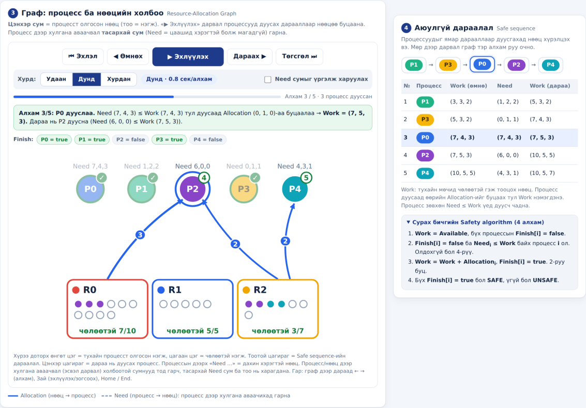

# 1. Хэрэглэгчийн заавар

## 1.1 Програмын зорилго

Энэ программ процесс нөөц хүсэхэд уг хүсэлтийг олгосны дараа бүх
процесс дуусах аюулгүй дараалал үлдэх эсэхийг шалгана. Терминалаар
хүсэлтүүдийг дараалуулан туршиж болно. Вэб интерфейсээр ижил тооцоог
хүснэгт, нөөцийн граф, алхам бүрийн Work вектороор ажиглана.

## 1.2 Ажиллуулах шаардлага

Python 3.10 буюу түүнээс шинэ хувилбар, JavaScript идэвхтэй хөтөч
хэрэгтэй. Вэб сервер болон CLI нь Python-ийн стандарт санг ашигладаг.
Автомат тест ажиллуулахад `pytest` хэрэгтэй. Бодитоор туршсан орчныг
2.2-т үзүүлэв.

## 1.3 Вэб интерфейсийг нээх

Төслийн үндсэн хавтсанд `python src/server.py` командыг ажиллуулаад
хөтчөөр `http://127.0.0.1:5000` хаягийг нээнэ. Эхлэхэд номын таван
процесс, гурван төрлийн нөөцтэй жишээ ачаалагдана. Серверийг
зогсоохдоо терминалдаа `Ctrl+C` дарна.

## 1.4 Оролт ба тохиргоо

- **Available** — тухайн мөчид сул байгаа нөөц. Номын жишээнд `(3,3,2)`.
- **Max** — процесс төрөл бүрээс дээд тал нь хэдэн нэгж ашиглахыг заана.
- **Allocation** — процессын одоо эзэмшиж буй нөөц.
- **Need** — үлдсэн хэрэгцээ. `Max − Allocation` гэж автоматаар бодно.

Зүүн талын хүснэгтийн тоог өөрчилсний дараа **«Шалгах»** дарж
баталгаажуулна. Батлах хүртэл хүсэлт илгээх, нөөц чөлөөлөх болон
Banker-ийн горим солих үйлдэл түгжигдэнэ. Хүснэгтэд дээд тал нь
20 процесс, 8 төрлийн нөөц оруулж болно.

Баруун талд процессоо сонгож, R0, R1, R2 нүдэнд хүсэх эсвэл чөлөөлөх
хэмжээгээ бичнэ. **«Хүсэлт илгээх»** нь нөөц авна.
**«Нөөц чөлөөлөх (Release)»** нь сонгосон процессын эзэмшиж буй
нөөцөөс буцаана.

## 1.5 Алхмаар тоглуулах, төлөв сэргээх

Графын **«Дараах»** товчоор нэг процесс дуусахад Work хэрхэн
өөрчлөгдөхийг харна. **«Өмнөх»** товч нэг алхам ухраана.
Тоглуулагч нь Safety шалгалтын тооцоог харуулдаг тул алхам солиход
серверийн бодит хуваарилалт өөрчлөгдөхгүй.

**«Анхны төлөв (Reset)»** хамгийн сүүлд ачаалсан өгөгдлийг сэргээнэ.
**«Номын жишээг оруулах»** товч номын матрицыг дахин ачаалж, Banker
горимыг асаан, хүсэлтийн нүднүүдийг тэглэнэ.

## 1.6 Графын тэмдэг ба Need сум

Дугуй нь процесс, хүрээтэй хайрцаг нь нөөцийн төрөл. Нөөцөөс процесс
руу чиглэсэн цэнхэр сум тухайн процесст олгосон Allocation-ийг харуулна.
Хайрцаг доторх цагаан цэг нь сул нэгж юм.

**Need-ийн тасархай сум анх нуугдсан байдаг.** Нэг процессын үлдсэн
хэрэгцээг харахын тулд граф дээрх тухайн процессын дугуй дээр хулганаа
аваачих эсвэл дарна. Бүх процессын Need сумыг зэрэг харахын тулд
**«Need сумыг үргэлж харуулах»** сонголтыг асаана. Тасархай сум
процессоос нөөц рүү чиглэнэ.

{width=95%}

## 1.7 Давтан турших жишээнүүд

**Жишээ 1. Номын хүсэлтүүд.** «Номын жишээг оруулах» товч дарж
Banker асаалттайг шалгана. Дараах гурван хүсэлтийг дунд нь жишээг
дахин ачаалахгүйгээр илгээнэ.

| Алхам | Хүсэлт | Хүлээгдэх үр дүн |
|---|---|---|
| 1 | P1 `(1,0,2)` | `granted`. Available `(2,3,0)` болно. |
| 2 | P4 `(3,3,0)` | `wait`. R0-оос 3 хүссэн ч 2 сул байна. |
| 3 | P0 `(0,2,0)` | `unsafe`. Түр олголтыг буцааж, Available `(2,3,0)` хэвээр үлдэнэ. |

**Жишээ 2. Release хийж SAFE төлөвт шилжих.** «Unsafe эхний төлөв»
гэсэн 3×2 жишээг сонгоно. P0 дээр `(2,1)` оруулаад Release дарна.
Available `(3,2)` болж, `P1 → P0 → P2` аюулгүй дараалал гарна.

**Жишээ 3. Banker-гүй горим.** «Banker-гүй: UNSAFE төлөвт хүрэх»
жишээг сонгоод P1 `(1,0,2)`, дараа нь P0 `(0,2,0)` илгээнэ. Хоёул
олгогдож Available `(2,1,0)` үлдэнэ. Энэ төлөвт бүх процессыг
дуусгах аюулгүй дараалал олдохгүй. Дахин Жишээ 1-ийг туршихдаа
«Номын жишээг оруулах» товч дарна.

**Жишээ 4. Ижил хүсэлтүүдийг CLI-аар ажиллуулах.** Доорх командыг
төслийн үндсэн хавтсанд **нэг мөрөөр** оруулна. `--commands` сонголт
командуудыг файлаас уншина.

```text
python src/cli.py 10 5 7 --max examples/book_max.txt --allocation examples/book_allocation.txt --commands examples/book_commands.txt
```

Эхний төлөв SAFE байна. Дараа нь `granted`, `wait`, `unsafe` гэсэн
гурван хариу дарааллаар гарч, эцсийн төлөв SAFE хэвээр үлдэнэ.
Гараар команд оруулах бол `--commands` болон түүний файлын замыг
орхино. `RQ` нөөц хүснэ, `RL` нөөц чөлөөлнө, `*` төлөв хэвлэнэ,
`exit` программаас гарна.

## 1.8 Түгээмэл алдаа ба шийдэл

| Шинж | Шийдэл |
|---|---|
| Хүсэлт илгээх товч идэвхгүй | Хүснэгт зассан бол «Шалгах» дарж баталгаажуулна. |
| Need сөрөг гарсан | Тухайн процессын Allocation нь Max-аас хэтэрсэн нүдийг засна. |
| CLI файл олохгүй | `src`, `examples`, `tests` хавтастай төслийн үндсэн хавтсаас ажиллуулна. |
| 5000 порт завгүй | `python src/server.py --port 5001` гэж асаагаад `http://127.0.0.1:5001` хаягийг нээнэ. |

# 2. Суулгалт ба туршилтын заавар

## 2.1 Эх код авах

```bash
git clone https://github.com/jal0115/os-bd1-IV-2-13-bankers-algorithm.git
cd os-bd1-IV-2-13-bankers-algorithm
git switch bd2-step1
```

## 2.2 Туршсан орчин

| Хувилбар | Туршсан тал ба орчин | Үр дүн |
|---|---|---|
| БД1 | II-4-10 баг. Windows 11, Python 3.14.7, Chrome | 64 автомат тест тэнцсэн. |
| БД2 | IV-2-13 баг. Debian 13, Python 3.13.5, pytest 9.1.1. Вэб интерфейсийг Firefox дээр шалгасан. | 9 файл дахь 75 автомат тест тэнцсэн. |

БД2-ын 75 тестийн дүн Debian-д хамаарна. БД2 хувилбарыг Windows
PowerShell болон macOS дээр тусад нь ажиллуулсан дүн бүртгэгдээгүй.

## 2.3 Тестийн орчин бэлдэх

Debian дээр төслийн үндсэн хавтсанд дараах командуудыг ажиллуулна.

```bash
python3 -m venv .venv
source .venv/bin/activate
python -m pip install -r requirements.txt
```

Windows PowerShell дээр виртуал орчны Python-ийг шууд дуудаж болно.

```powershell
python -m venv .venv
.\.venv\Scripts\python.exe -m pip install -r requirements.txt
.\.venv\Scripts\python.exe -m pytest -q
```

## 2.4 Ажиллуулах команд

Тусдаа build алхам шаардлагагүй. Идэвхтэй виртуал орчинд
`python src/server.py` командаар вэб серверийг асаана.
`python -m pytest -q` командаар бүх автомат тестийг ажиллуулна.

## 2.5 Үндсэн тестийн өгөгдөл ба хүлээгдэх үр дүн

Номын жишээний нийт нөөц `(10,5,7)`. Max ба Allocation матрицыг
файлаас уншихад анхны Available `(3,3,2)` гарна. Дараах командыг
төслийн үндсэн хавтсанд нэг мөрөөр ажиллуулна.

```text
python src/cli.py 10 5 7 --max examples/book_max.txt --allocation examples/book_allocation.txt --commands examples/book_commands.txt
```

Эхний аюулгүй дараалал `P1 → P3 → P0 → P2 → P4`. Хүсэлтүүдийн
хариуг 1.7 дахь Жишээ 1-ийн хүснэгттэй тулгана. Автомат тестийн
хүлээгдэх үр дүн `75 passed`.

## 2.6 Захын тохиолдол

- Номын эхний төлөвт P0-оос `(99,0,0)` хүсэхэд R0-ийн Need 7-оос
  хэтэрсэн тул `error` гарна. Хуваарилалт өөрчлөгдөхгүй.
- 10×5 жишээнд гурван нөөц нэмэхэд нөөцийн тоо 8 хүрч, нэмэх товч
  идэвхгүй болно. Нэг нөөц хасахад товч дахин идэвхжинэ.
- `--commands` сонголтод байхгүй файл өгвөл CLI файлын нэртэй
  алдааны мэдэгдэл хэвлэж, гаралтын код 2 буцаана.

## 2.7 Үр дүнг шалгах

P0-ийн хүсэлтэд `unsafe` хариу гарсны дараа системийн төлөв SAFE
хэвээр байж болно. Түр олголтыг буцаасан учраас Available болон
P0-ийн Allocation хүсэлтийн өмнөх утгатайгаа тэнцүү байна.

## 2.8 Төлөв ба түүхийн хадгалалт

Нэг серверт холбогдсон табууд нөөцийн хуваарилалтыг хуваалцана.
Хүсэлтийн түүх таб бүрд тусдаа. Хуудсыг шинэчлэхэд түүх, тоолуур
тэглэгдэх боловч сервер ажиллаж байгаа үед хуваарилалт хадгалагдана.
Серверийг дахин асаахад номын анхны жишээ ачаалагдана.
